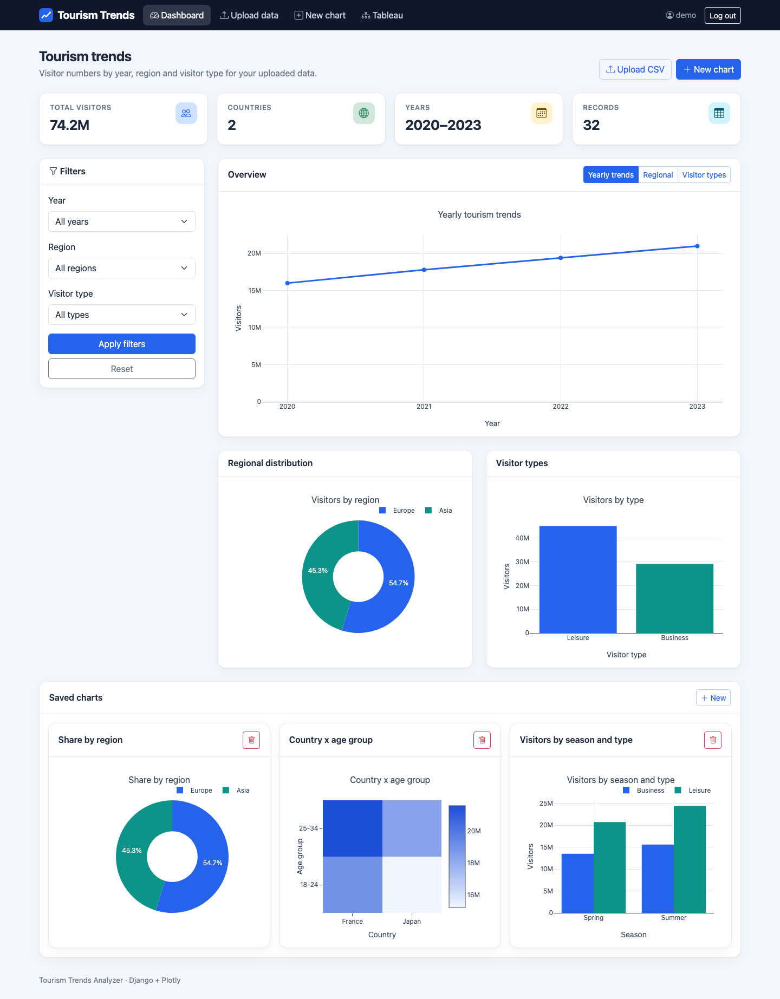
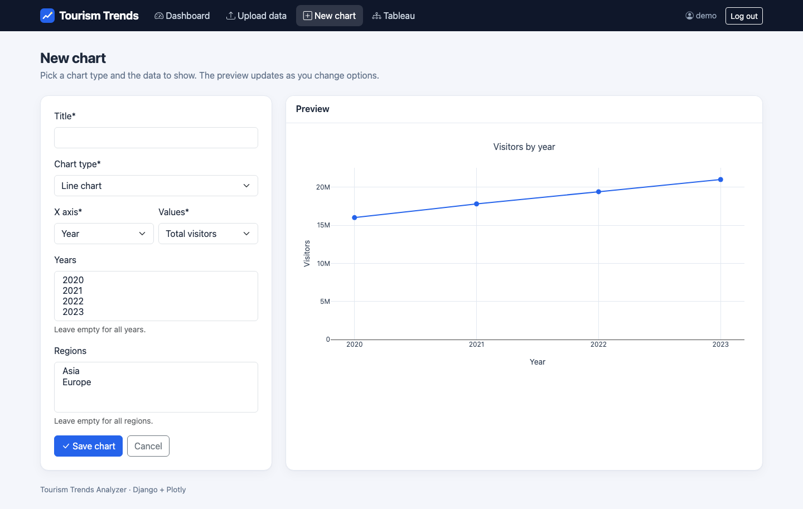
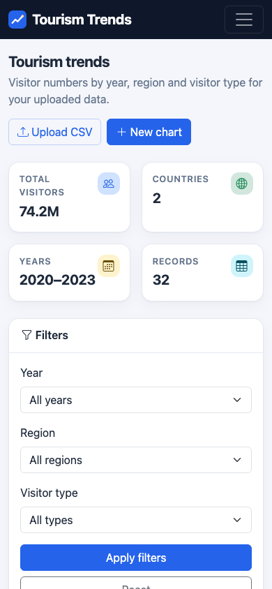

# Tourism Trends Analyzer

A Django web app for uploading tourism datasets and exploring them through interactive Plotly charts, with CSV export and a Web Data Connector for Tableau.


## Overview

The project has two parts:

1. **Django dashboard** (`tourism_analyzer/` + `tourism_dashboard/`): logged-in users upload tourism CSVs, filter their data and view yearly, regional and visitor-type charts. They can save their own chart definitions and take their data into Tableau. Each user only ever sees their own data.
2. **Stand-alone analysis script** (`src/`): a pandas + Plotly pipeline that reads `data/tourism_data.csv` and writes interactive HTML charts and Tableau-ready CSVs to `output/`.



## Features

### Web dashboard

- **Authentication**: Django login/logout. Every page and JSON endpoint requires login.
- **CSV upload** with validation (required columns, whole-number counts, no empty cells, size limit). Optionally replaces your existing rows instead of adding to them. Errors point to the offending row.
- **Sample data**: one click loads `data/tourism_data.csv` into an empty account
- **Summary cards**: total visitors, countries, year span, record count
- **Interactive charts** (Plotly.js), fed by a JSON endpoint, with loading, empty and error states:
  - Yearly visitor trend (line)
  - Regional distribution (donut)
  - Visitors by type, Business vs Leisure (bar)
- **Filters**: year (single year or full range), region and visitor type. The selected main chart and filters are remembered per user.
- **Saved charts**: line, bar, pie, scatter or heatmap of visitors by year, country, region or season, optionally split by visitor type or age group, filtered by years and regions. A live preview updates while you edit, and saved charts render on the dashboard.
- **Tableau integration**
  - Download your data as CSV (`/export-tableau/`)
  - Show a Tableau Public view on the page from its share link
  - A Tableau Web Data Connector (`/tableau-wdc/`) that loads your data into Tableau Desktop after you log in
- **Django admin** at `/admin/` for all models

### Analysis script (`src/main.py`)

- Yearly trends, regional comparison, visitor demographics (age group × visitor type), seasonal patterns and top-10 destinations
- Writes interactive Plotly HTML files (plotly.js loaded from the CDN) and matching CSVs to `output/`

## Tech stack

- Python 3.10+, Django 5.2 LTS
- pandas, NumPy
- Plotly (Python, in `src/`) and Plotly.js 2.35 (CDN, dashboard)
- django-crispy-forms 2 + crispy-bootstrap5, Bootstrap 5.3, Bootstrap Icons
- python-dotenv
- SQLite (Django default)

## Project structure

```
tourism-trends/
├── manage.py
├── requirements.txt
├── .env.example
├── tourism_analyzer/          # Django project: settings (env-driven), root URLs, WSGI/ASGI
├── tourism_dashboard/         # Django app
│   ├── models.py              # TourismData, UserDashboard, CustomVisualization
│   ├── charts.py              # Filtering + Plotly figure builders
│   ├── views.py               # Dashboard, upload, chart APIs, Tableau export/WDC
│   ├── forms.py               # CSV validation, chart form
│   ├── urls.py
│   ├── tests.py
│   ├── templatetags/
│   ├── migrations/
│   └── templates/tourism_dashboard/
├── static/                    # app.css, charts.js, favicon
├── src/                       # Stand-alone pandas/Plotly analysis
│   ├── main.py
│   ├── data_processor.py
│   └── visualizer.py
├── data/tourism_data.csv      # Sample dataset
├── sample_data.csv            # Second sample dataset for upload
└── docs/screenshots/
```

## Getting started

### Prerequisites

- Python 3.10 or newer

### Install

```bash
git clone https://github.com/VamsiKrishnaThota03/tourism-trends.git
cd tourism-trends

python -m venv venv
source venv/bin/activate        # Windows: venv\Scripts\activate
pip install -r requirements.txt
cp .env.example .env            # then set DJANGO_DEBUG=true for local development
```

### Run the web app

```bash
python manage.py migrate
python manage.py createsuperuser
python manage.py runserver      # http://127.0.0.1:8000/
```

Log in, then click **Load sample data** on the empty dashboard, or go to **Upload data** and upload `data/tourism_data.csv` or `sample_data.csv`.

The SQLite database is not committed. `migrate` creates a fresh one.

### Tests

```bash
DJANGO_DEBUG=true python manage.py test tourism_dashboard
```

### Run the analysis script

```bash
python src/main.py              # works from any directory; writes to output/
```

### Environment variables

| Variable | Required | Default | Purpose |
|----------|----------|---------|---------|
| `DJANGO_SECRET_KEY` | yes, unless `DJANGO_DEBUG=true` | none | Django signing key. Generate with `python -c "import secrets; print(secrets.token_urlsafe(50))"` |
| `DJANGO_DEBUG` | no | `false` | `true` for local development only |
| `DJANGO_ALLOWED_HOSTS` | no | `localhost,127.0.0.1` | Comma-separated host names |
| `DJANGO_CSRF_TRUSTED_ORIGINS` | when served over HTTPS behind a proxy | empty | e.g. `https://your-app.example.com` |
| `DJANGO_SECURE_COOKIES` | no | `true` when debug is off | Set `false` only to try a non-debug build over plain HTTP |
| `SQLITE_PATH` | no | `./db.sqlite3` | SQLite database file |
| `MAX_UPLOAD_BYTES` | no | `5242880` (5 MB) | Largest CSV accepted |

## Data format

Uploaded CSVs must include these columns:

| Column | Example |
|--------|---------|
| `Year` | `2020` |
| `Country` | `France` |
| `Region` | `Europe` |
| `Visitor_Count` | `1500000` |
| `Visitor_Type` | `Business` / `Leisure` |
| `Season` | `Spring` |
| `Age_Group` | `18-24` |

## Endpoints

All endpoints except login require a logged-in user and only read or change that user's data.

| Method | Path | Purpose |
|--------|------|---------|
| `GET` | `/` | Dashboard |
| `GET`/`POST` | `/upload/` | Upload a CSV |
| `POST` | `/load-sample/` | Replace your data with the bundled sample dataset |
| `GET`/`POST` | `/create-visualization/` | Create a saved chart |
| `POST` | `/delete-visualization/<id>/` | Delete a saved chart |
| `POST` | `/update-preferences/` | Save default view and filters (JSON) |
| `GET` | `/api/visualization/<view_type>/` | Built-in chart data (`yearly_trends`, `regional_distribution`, `demographics`; `?year_range=2020-2023&region=&visitor_type=`) |
| `GET` | `/api/custom-visualization/<id>/` | Figure for a saved chart |
| `GET` | `/api/chart-preview/` | Figure for unsaved chart options |
| `GET` | `/export-tableau/` | Download your data as CSV |
| `GET` | `/tableau-dashboard/` | Tableau instructions and Tableau Public viewer |
| `GET` | `/tableau-wdc/`, `/tableau-wdc/data/` | Tableau Web Data Connector page and its JSON data |
| `GET` | `/debug/data/` | Your record count and a 5-row sample |
| `GET`/`POST` | `/login/`, `POST` `/logout/` | Authentication |
| `GET` | `/admin/` | Django admin (staff) |

## Screenshots

| New chart with live preview | Mobile |
|---|---|
|  |  |

## Known limitations

- Uploaded rows are stored as-is; uploading the same file twice without "replace" duplicates them.
- The Web Data Connector uses Tableau's WDC 2 library, which Tableau has deprecated in favour of WDC 3 (Tableau 2023.1+).
- Only Tableau Public views can be embedded on the Tableau page.
- SQLite is the only configured database.

## Contact

Thota Vamsi Krishna — [GitHub](https://github.com/VamsiKrishnaThota03)
